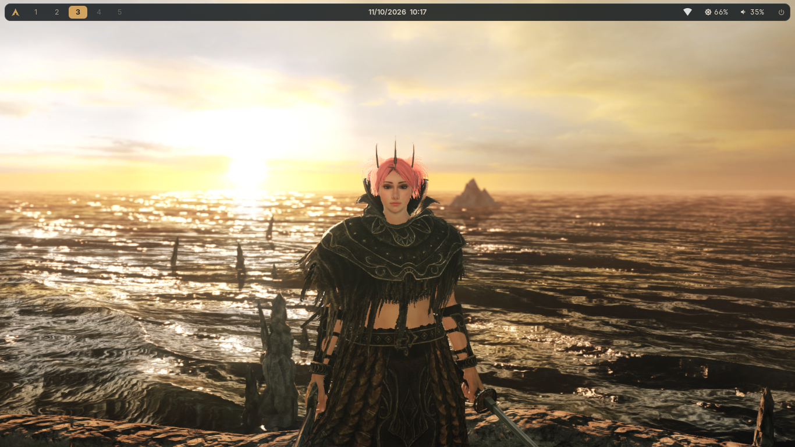
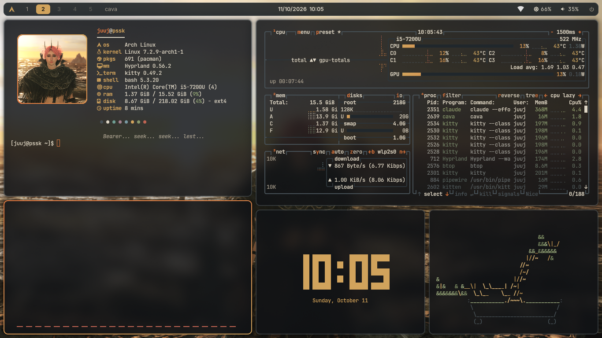
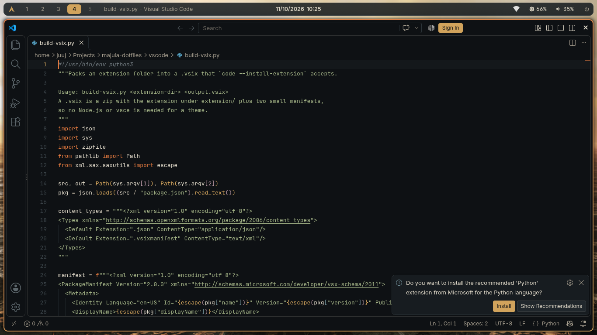

# Majula dotfiles

A warm, dark Hyprland desktop for Arch Linux inspired by Majula from Dark Souls II: ember and gold on charcoal, with the sea at sunset as the wallpaper.







## What's inside

| Part | Files |
|---|---|
| Hyprland look, autostart and keybinds | `home/.config/hypr/majula.lua` |
| Wallpaper, lock screen and idle | `home/.config/hypr/hyprpaper.conf`, `hyprlock.conf`, `hypridle.conf` |
| Bar, launcher and notifications | `home/.config/waybar/`, `rofi/`, `dunst/` |
| Terminal | `home/.config/kitty/kitty.conf` |
| GTK, Qt and KDE apps (Dolphin) in dark Majula | `home/.config/gtk-3.0/`, `gtk-4.0/`, `qt6ct/`, `kdeglobals`, `home/.local/share/color-schemes/` |
| VS Code theme and settings | `vscode/majula-theme/`, `home/.config/Code/User/settings.json` |
| Rice showcase | `home/.config/hypr/scripts/rice`, `home/.config/fastfetch/`, `cava/`, `btop/` |
| Keypad keyboard option | `home/.config/xkb/` |
| Login screen (SDDM) and system settings | `system/` |

The setup targets one notebook (Samsung 300E5M, 1366x768, Hyprland 0.56 with the Lua config under UWSM, SDDM, ABNT2 keyboard), so sizes are tuned for that screen.

## Install

1. Install the packages:

   ```bash
   grep -v '^#' packages.txt | sudo pacman -S --needed -
   grep -v '^#' packages-aur.txt | yay -S --needed -
   ```

2. Copy the dotfiles into your home folder. Files that would be replaced are backed up to `~/.local/state/majula-backup/` first. Hyprland's own `hyprland.lua` is kept; the installer only adds `require("majula")` to its last line.

   ```bash
   ./install.sh
   ```

3. Apply the parts that need root: the SDDM login theme, Num Lock from boot, the ABNT2 keymap, and the lid and hibernation rules.

   ```bash
   sudo bash system/apply-system.sh
   ```

4. Reboot.

## Keybinds

| Keys | Action |
|---|---|
| `Super + Q` | Terminal (kitty) |
| `Super + R` | App launcher (Rofi) |
| `Super + E` | Files (Dolphin) |
| `Super + B` | Browser (Zen) |
| `Super + C` | Close window |
| `Super + F` | Fullscreen |
| `Super + V` | Toggle floating |
| `Super + L` | Lock screen |
| `Super + Escape` | Power menu |
| `Super + Shift + V` | Clipboard history |
| `Super + Shift + R` | Open or close the rice showcase |
| `Print` / `Shift + Print` | Screenshot of an area or the whole screen (saved and copied) |
| `Super + 1..0` or `Super + keypad 1..0` | Switch workspace (add `Shift` to move the window) |
| `Shift + keypad 1..0` | `! @ # $ % ¨ & * ( )`, like the number row |
| `AltGr + F1` / `AltGr + F4` | Send `F2` / `F5` |

The last three rows exist because the notebook's `5`, `6`, `F2` and `F5` keys are broken. The keypad always types numbers, whatever the Num Lock state.

## Rice

`rice` (or `Super + Shift + R`) opens fastfetch, btop, cava, tty-clock and cbonsai as neat panels on an empty workspace. Run it again to close them. Each panel also runs alone: `rice fetch`, `rice top`, `rice cava`, `rice clock` and `rice bonsai`. `pipes.sh` and `cmatrix` are installed too.

## Idle

The screen dims after 5 minutes, locks after 10 and turns off after 15. The notebook never hibernates, and closing the lid only locks it.

## Keeping the repo up to date

After changing something on the machine, copy the tracked files back and commit:

```bash
./sync.sh
git diff
```

## Palette

| Name | Hex | Used for |
|---|---|---|
| Background | `#0E1114` | Base of everything |
| Surface | `#171C20` | Panels and sidebars |
| Elevated | `#20272C` | Menus and popups |
| Border | `#465056` | Inactive borders |
| Text | `#DDD6C6` | Main text |
| Muted | `#A39B8C` | Secondary text |
| Accent | `#D1A35C` | Gold highlights |
| Ember | `#E0783E` | Focus and the active border |
| Info | `#7899A2` | Links and info |
| Success | `#87996D` | Strings and success |
| Danger | `#C06452` | Errors |

Fonts are Inter (interface), JetBrainsMono Nerd Font (terminal and code) and Cormorant Garamond (clocks). Icons are Papirus-Dark.
