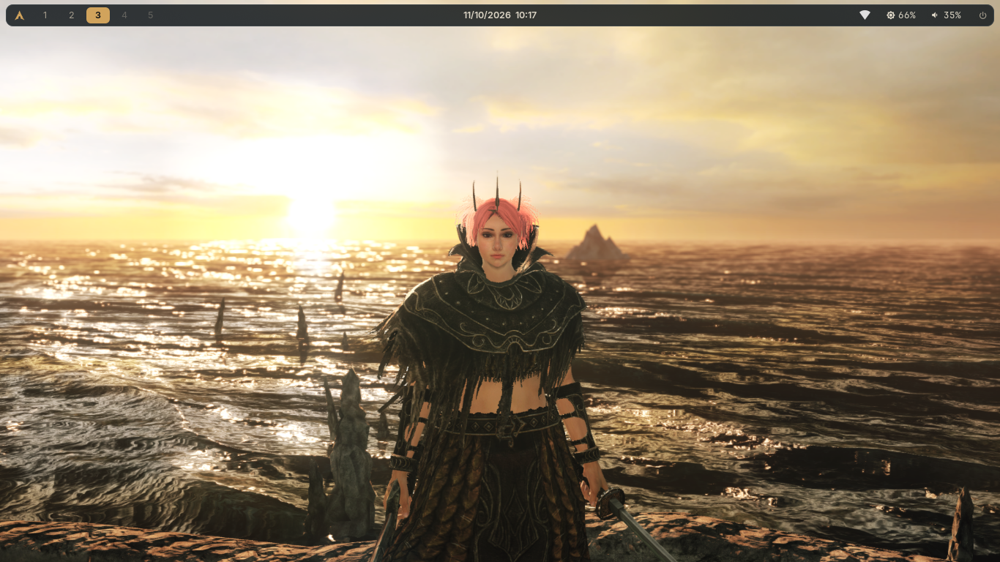
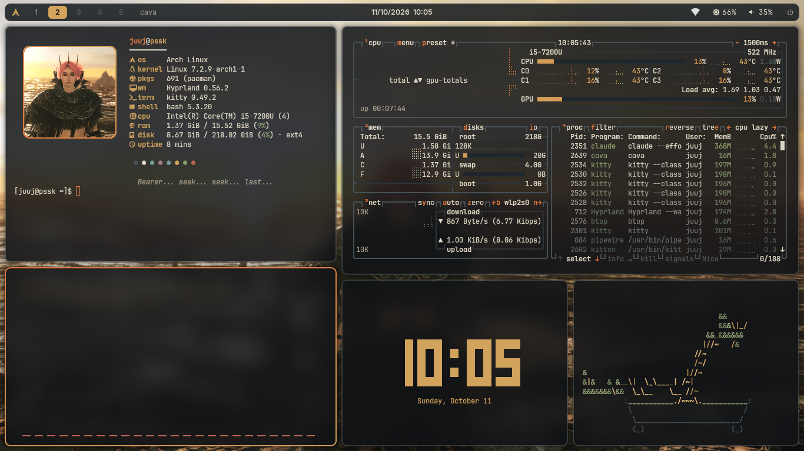
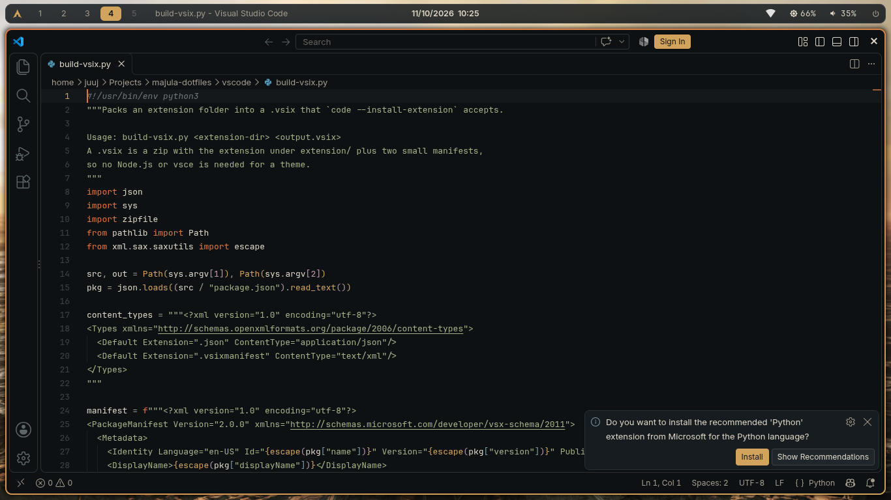

# Majula dotfiles

A warm, dark Hyprland desktop for Arch Linux inspired by Majula from Dark Souls II: ember and gold on charcoal, with the sea at sunset as the wallpaper.







## What's inside

| Part | Files |
|---|---|
| Hyprland look, autostart and keybinds | `home/.config/hypr/majula.lua` |
| Wallpaper, lock screen and idle | `home/.config/hypr/hyprpaper.conf`, `hyprlock.conf`, `hypridle.conf` |
| Bar, launcher and notifications | `home/.config/waybar/`, `rofi/`, `swaync/` |
| Bonfire menu (Dark Souls II style launcher) | `home/.config/hypr/scripts/bonfire`, `home/.config/rofi/bonfire.rasi` |
| Dark Souls II font, menu art, cursor, loading screen and the Qt theme, built from your copy of the game | `ds2-extract/` (see its [README](ds2-extract/README.md)) |
| Qt apps (Dolphin) in Dark Souls II style | `home/.config/Kvantum/`, `home/.config/qt6ct/` |
| Sound effects for the headset (mono + equalizer) | `home/.local/share/easyeffects/` |
| Terminal | `home/.config/kitty/kitty.conf` |
| GTK, Qt and KDE apps (Dolphin) in dark Majula | `home/.config/gtk-3.0/`, `gtk-4.0/`, `qt6ct/`, `kdeglobals`, `home/.local/share/color-schemes/` |
| VS Code theme and settings | `vscode/majula-theme/`, `home/.config/Code/User/settings.json` |
| Rice showcase | `home/.config/hypr/scripts/rice`, `home/.config/fastfetch/`, `cava/`, `btop/` |
| Keypad keyboard option | `home/.config/xkb/` |
| Login screen (SDDM), boot screen, Limine and system settings | `system/` |
| Windows side of the dual boot: same look, performance and cleanup | `windows/` |

The setup targets one notebook (Samsung 300E5M, 1366x768, Hyprland 0.56 with the Lua config under UWSM, SDDM, ABNT2 keyboard), so sizes are tuned for that screen.

## Install

1. Install the packages:

   ```bash
   grep -v '^#' packages.txt | sudo pacman -S --needed -
   grep -v '^#' packages-aur.txt | yay -S --needed -
   ```

2. Optional, needs Dark Souls II: Scholar of the First Sin from Steam. Build the Dark Souls II look from the game files: the bonfire menu, the Drangleic font, the loading screen, the cursor and the Qt theme (they stay in `ds2-assets/`, which git ignores):

   ```bash
   ds2-extract/extract
   ```

   Without it, everything keeps the plain Majula look and the boot stays as it was.

3. Copy the dotfiles into your home folder. Files that would be replaced are backed up to `~/.local/state/majula-backup/` first. Hyprland's own `hyprland.lua` is kept; the installer only adds `require("majula")` to its last line.

   ```bash
   ./install.sh
   ```

4. Apply the parts that need root: the SDDM login theme, automatic login, the Dark Souls II loading screen and silent boot, Limine, Num Lock from boot, the ABNT2 keymap, Bluetooth, and the lid and hibernation rules.

   ```bash
   sudo bash system/apply-system.sh
   ```

5. Reboot.

## Keybinds

| Keys | Action |
|---|---|
| `Super + Q` | Terminal (kitty) |
| `Super + R` | Bonfire menu (again closes it) |
| `Super + E` | Files (Dolphin) |
| `Super + B` | Browser (Zen) |
| `Super + C` | Close window |
| `Super + F` | Fullscreen |
| `Super + V` | Toggle floating |
| `Super + L` | Lock screen |
| `Super + Escape` | Burn: lock, log out, suspend, reboot, shut down |
| `Super + Shift + V` | Item box: clipboard history |
| `Super + Shift + R` | Open or close the rice showcase |
| `Print` / `Shift + Print` | Screenshot of an area or the whole screen (saved and copied) |
| `Super + 1..0` or `Super + keypad 1..0` | Switch workspace (add `Shift` to move the window) |
| `Shift + keypad 1..0` | `! @ # $ % ¨ & * ( )`, like the number row |
| `AltGr + F1` / `AltGr + F4` | Send `F2` / `F5` |

The last three rows exist because the notebook's `5`, `6`, `F2` and `F5` keys are broken. The keypad always types numbers, whatever the Num Lock state.

## Rice

`rice` (or `Super + Shift + R`) opens fastfetch, btop, cava, tty-clock and cbonsai as neat panels on an empty workspace. Run it again to close them. Each panel also runs alone: `rice fetch`, `rice top`, `rice cava`, `rice clock` and `rice bonsai`. `pipes.sh` and `cmatrix` are installed too.

## Bluetooth

Click the Bluetooth icon in the bar (left of Wi-Fi) to connect or disconnect a paired device, or to turn Bluetooth on and off. Right-click it, or pick "Pair a new device", to open Blueman and pair something new.

## Bonfire menu

`Super + R` (or the icon at the left of the bar) opens the bonfire menu, drawn like the one in Dark Souls II when you rest at a bonfire:

| Entry | What it does |
|---|---|
| Travel | Apps, grouped into areas (Games, Internet, Development, Multimedia...). With Windows installed, "Drangleic (Windows)" restarts into Windows. |
| Attune spells | Sound: open the equalizer, load a preset, bypass the effects |
| Burn | Lock, log out, suspend, reboot, shut down (and reboot into Windows) |
| Item box | Clipboard history |

Esc goes back one menu, like B in the game. Typing filters the list; typing an app name on the first menu searches all apps. Each part also opens on its own: `bonfire travel`, `bonfire attune`, `bonfire burn`, `bonfire items`.

## Sound

The headset is a Redragon Zeus with a Bluetooth receiver built in, and only one channel reaches the speakers. EasyEffects runs in the background (no window until you open it) and loads a preset by itself when the output changes:

- **Redragon Zeus** (the headset): mono (both channels mixed), a 16-band equalizer from 20 Hz to 20 kHz, flat until you tune it, and a limiter
- **Flat** (the notebook speakers): no effects

Open the equalizer from Attune spells and save over the preset after tuning. Install it with `sudo pacman -S easyeffects lsp-plugins-lv2 calf`. The headset was renamed for every app with:

```bash
busctl set-property org.bluez /org/bluez/hci0/dev_41_42_C3_40_87_A3 org.bluez.Device1 Alias s "Redragon Zeus"
```

## Boot

With the DS2 art built and `plymouth` installed, `apply-system.sh` hides all boot text and shows the Dark Souls II loading screen instead: the book, the bonfire burning in the corner and one random item (of 48 picked when the theme was built) with its description. It fades in from black, the item a moment later like in the game, stays at least about 10 seconds (time to read the item; `/usr/local/lib/majula/hold-loading-screen`), and fades back to black. Then the desktop starts directly (automatic login). Shutting down and rebooting show the same screen for 5 seconds and power off once it has faded to black (`majula-hold-shutdown-screen.service`). Run `ds2-extract/extract boot` and `apply-system.sh` again for 48 new items.

The password is still asked by the lock screen (lid, idle, `Super + L`). To get the login screen back at boot, delete `/etc/sddm.conf.d/20-majula-autologin.conf`.

The Limine menu is hidden; hold any key while the notebook starts to see it. It has a second entry, "Arch Linux (safe, text boot)", that boots with all the usual text and no splash, for when something goes wrong.

## Dual boot with Windows

1. Run `sudo bash system/apply-system.sh` **before** installing Windows. It backs up the boot partition to `/var/backups/majula/` and adds a second copy of Limine with its own firmware entry, "Majula (Limine)", because the Windows installer replaces `\EFI\BOOT\BOOTX64.EFI`, which is how this notebook starts Limine.
2. Shrink the Arch partition from a live USB (it can't shrink while mounted) and install Windows in the free space. 80 GB is plenty for Windows and some development.
3. If the notebook boots straight into Windows afterwards, open the firmware boot menu and pick "Majula (Limine)".
4. Back in Arch, run `sudo bash system/apply-system.sh` again. It puts Limine back in place, adds Windows to the Limine menu, and enables "Drangleic (Windows)" in Travel and "Reboot into Windows" in Burn (it sets the next boot to Windows once and restarts).
5. In Windows, keep the clock right (Linux stores UTC) and turn off Fast Startup. "2 - Performance and cleanup" from the [Windows kit](#windows) does both; by hand, from an admin terminal:

   ```bat
   reg add "HKLM\System\CurrentControlSet\Control\TimeZoneInformation" /v RealTimeIsUniversal /t REG_DWORD /d 1 /f
   powercfg /h off
   ```

Restarting from Windows starts Arch again, because Limine comes first. Hold a key while the notebook starts and pick "Windows" in the Limine menu to go back.

## Windows

Windows gets the same look where it lets you change it, plus a performance and cleanup pass. From Arch, `sudo bash windows/copy-to-windows` puts a "Majula" folder on the Windows desktop. It refuses while Windows is hibernated by Fast Startup, since writing to it then can corrupt it. In Windows, run the folder's two scripts; each asks for admin rights and can be run again.

**1 - Majula theme** (`windows/theme.ps1`)

- The Majula wallpaper on the desktop and the lock screen, without Spotlight pictures or tips
- Dark mode with the gold accent (`#D1A35C`), saved as the "Majula" theme in Settings
- The game's cursor (only the arrow, like on Arch), also listed as the "Majula" pointer scheme
- Drangleic and JetBrainsMono Nerd Font installed
- Windows Terminal with kitty's colors, font, opacity and padding (its old settings are kept as `settings.json.majula-backup`)
- VS Code with the Majula theme, and the Arch settings added on top of the existing ones (also backed up)

**2 - Performance and cleanup** (`windows/tune.ps1`)

- Clock in UTC, and Fast Startup and hibernation off, for the dual boot
- Ultimate Performance power plan: the CPU stays at full speed, on battery too. The screen turns off after 15 minutes; no sleep when plugged in
- No animations or transparency (shadows and font smoothing stay), Game Mode on, background game recording off
- No ads, tips, suggested apps or web results in Start; no advertising ID, feedback prompts or telemetry service (DiagTrack); Windows Update downloads only from Microsoft
- No Widgets or Task View button, search as an icon, file extensions shown, Explorer opens on This PC
- Removes preinstalled extras such as Clipchamp, News, Weather, Solitaire, Teams, the new Outlook, Copilot and promoted apps (Spotify, TikTok...), when present. Store, Edge, OneDrive, Xbox and the basic apps stay
- Clears temporary files and old update files

Left alone on purpose: the system font (Windows has no setting for it, and registry tricks leave parts of it broken) and the Windows boot animation (changing it means patching boot files, which can break the dual boot). To pick another lock screen picture later, delete the `HKLM\SOFTWARE\Microsoft\Windows\CurrentVersion\PersonalizationCSP` key.

## Idle

The screen dims after 5 minutes, locks after 10 and turns off after 15. The notebook never hibernates, and closing the lid only locks it.

## Keeping the repo up to date

After changing something on the machine, copy the tracked files back and commit:

```bash
./sync.sh
git diff
```

## Palette

| Name | Hex | Used for |
|---|---|---|
| Background | `#0E1114` | Base of everything |
| Surface | `#171C20` | Panels and sidebars |
| Elevated | `#20272C` | Menus and popups |
| Border | `#465056` | Inactive borders |
| Text | `#DDD6C6` | Main text |
| Muted | `#A39B8C` | Secondary text |
| Accent | `#D1A35C` | Gold highlights |
| Ember | `#E0783E` | Focus and the active border |
| Info | `#7899A2` | Links and info |
| Success | `#87996D` | Strings and success |
| Danger | `#C06452` | Errors |

Fonts are Drangleic (traced from the game: the bonfire menu, the bar, notifications and Qt apps), Inter (GTK apps), JetBrainsMono Nerd Font (terminal and code) and Cormorant Garamond (the lock screen clock). Icons are Papirus-Dark with brown folders (Papirus-Dark-Majula, made by `install.sh`). The cursor is the game's menu cursor (Drangleic).

Qt apps like Dolphin use the Kvantum theme Drangleic: the dark leather of the in-game menus, the bonfire menu's orange bar for selections and the game's colours. Notifications (swaync) use the same leather.
